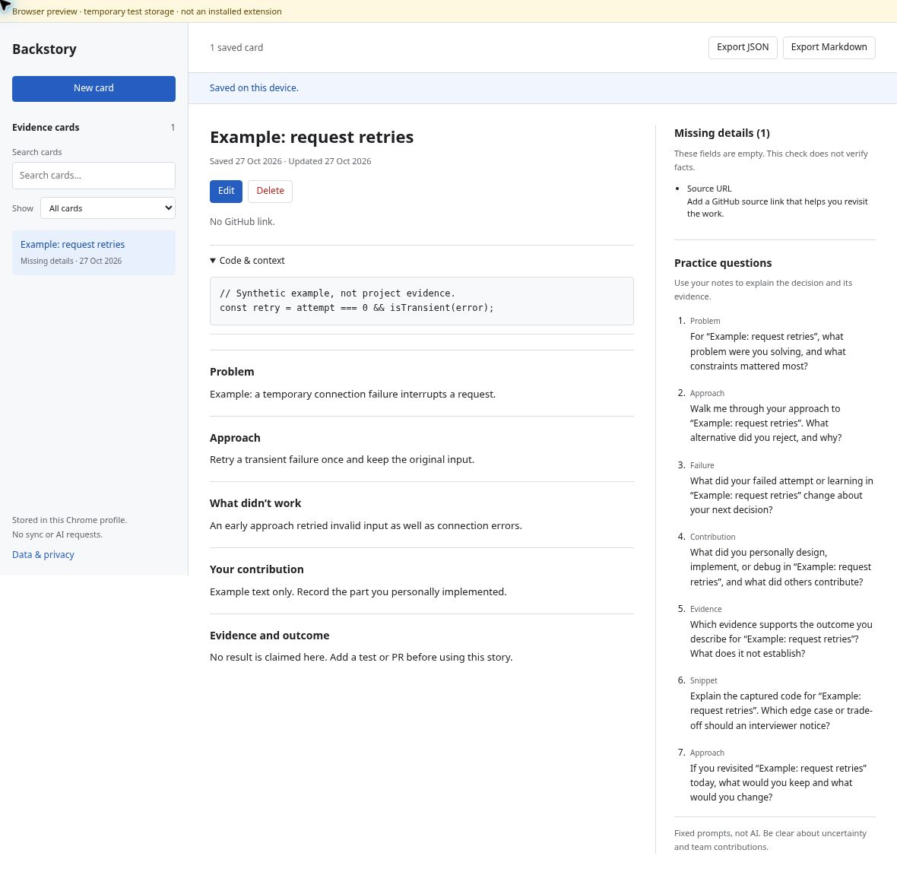
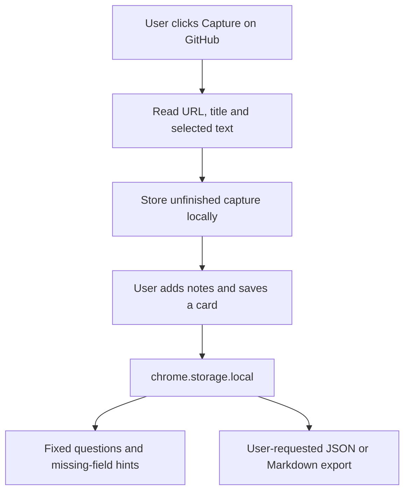

# Backstory

A Chrome extension for saving GitHub links, selected code, and your own notes as evidence cards. It stores cards locally, generates fixed interview-practice questions, and exports JSON or Markdown.

Developed with Codex assistance. This is an MVP, not an evidence-verification tool.

## Install

Requires desktop Chrome 114 or newer. No build step or account is needed.

1. Clone or download this repository.
2. Open `chrome://extensions` and enable **Developer mode**.
3. Choose **Load unpacked** and select the `extension/` directory containing `manifest.json`.
4. Pin Backstory from Chrome’s extensions menu.

For the source ZIP, unzip it first and select `backstory/extension`. This is an unpacked extension, not a Chrome Web Store release or an Android app.

## Use

1. Open a repository page on `github.com`. Optionally select code.
2. Open Backstory and choose **Capture page**.
3. Add the problem, approach, failed attempts or limitations, your contribution, and supporting evidence. Only a title is required.
4. Choose **Save**. The saved card includes seven rule-based practice questions and missing-field hints.

You can also start a blank card, search and filter saved cards, edit or delete them, and export the collection. For example, a card about a bug fix might link to the commit, explain the cause and your change, and record the regression test that supports it.

**Notes do not autosave.** Unfinished captures remain available under **Unfinished captures**. Exports include saved cards only, not unfinished captures or unsaved edits. A stale edit from a second window is rejected instead of overwriting a newer version.

## Interface



Browser-rendered UI preview with synthetic example data and temporary in-memory storage. This is not an installed-extension screenshot. [Capture details and checks](docs/UI-PREVIEW.md).

## Data flow



The extension has no runtime network calls. See [architecture and storage behavior](docs/ARCHITECTURE.md) for the module boundaries and revision checks.

## Privacy and limits

| Permission | Purpose |
| --- | --- |
| `activeTab` | Access the tab where you invoke Backstory. |
| `scripting` | Read its URL, title and selection after Capture; main frame only. |
| `storage` | Store cards and unfinished captures in this Chrome profile. |

- No whole-page scraping, broad host permissions, analytics, accounts, sync, background worker, or live AI. Extension CSP includes `connect-src 'none'`.
- Local storage and exports are **not encrypted**. Do not retain credentials or confidential code you are not allowed to keep. Review exports before sharing.
- Uninstalling removes local extension data. Export backups; deleting a card does not remove copies in exports or other backups. There is no import/restore UI yet.
- Source links must use HTTPS `github.com` repository paths. Query strings are removed; fragment anchors are retained. Links are not fetched or verified. GitHub Enterprise is unsupported.
- Limits: title 160, URL 2,048, selection 20,000, and each note 8,000 UTF-16 code units. Selection truncation is disclosed. Only the title is required.
- Filled fields do not establish authorship, accuracy, or outcomes. Practice questions use fixed templates, not AI. Record uncertainty and team contributions yourself.
- A damaged or future-version record is preserved rather than silently repaired. Do not clear storage or uninstall first; an advanced user can inspect and export the raw record through the extension’s DevTools.

`optional-server/` is a **disabled Gemini stub**, not a working integration. It is outside the extension runtime and cannot be enabled simply by changing an environment flag. See [adapter notes](optional-server/README.md).

## Develop and test

Requires Node 20.11+ and Python 3. No `npm install` is needed.

```sh
npm test          # Domain, storage, capture, adapter and UI-state tests
npm run check     # Syntax, manifest, local assets and no-network checks
npm run package   # Source ZIP in dist/
```

GitHub Actions runs these checks. Browser QA is separate and requires Python Playwright and Chromium:

```sh
npm run qa
# CHROMIUM_PATH=/path/to/chromium npm run qa
```

The extension QA script uses a disposable profile and synthetic data. Local browser launch was blocked in the build environment, so installed-extension end-to-end testing is **not verified**. The browser preview above was checked separately. The toolbar-to-GitHub permission flow, large collections, and screen-reader behavior still need user-environment testing. See [test coverage and manual checks](docs/TESTING.md).

Runtime code is in `extension/`; pure validation, questions, and export rules are in `extension/core/domain.js`; persistence is in `extension/core/storage.js`. Reload the extension after manifest changes.

## References

- [Chrome activeTab](https://developer.chrome.com/docs/extensions/develop/concepts/activeTab)
- [Chrome scripting API](https://developer.chrome.com/docs/extensions/reference/api/scripting)
- [Chrome storage API](https://developer.chrome.com/docs/extensions/reference/api/storage)
- [Load an unpacked extension](https://developer.chrome.com/docs/extensions/get-started/tutorial/hello-world)
