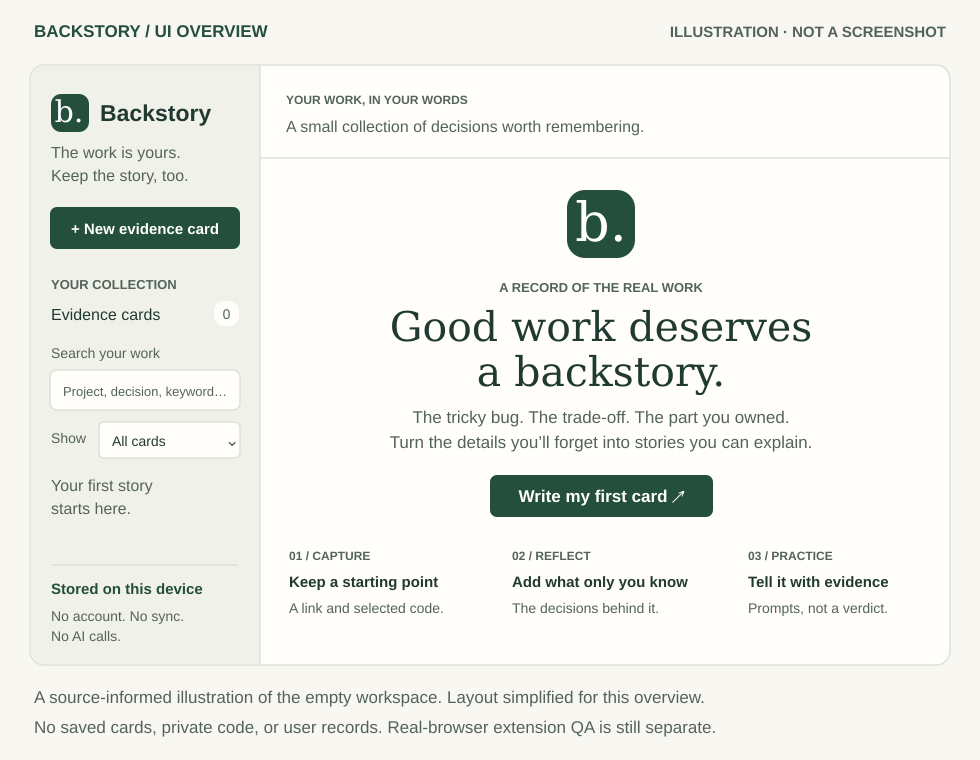
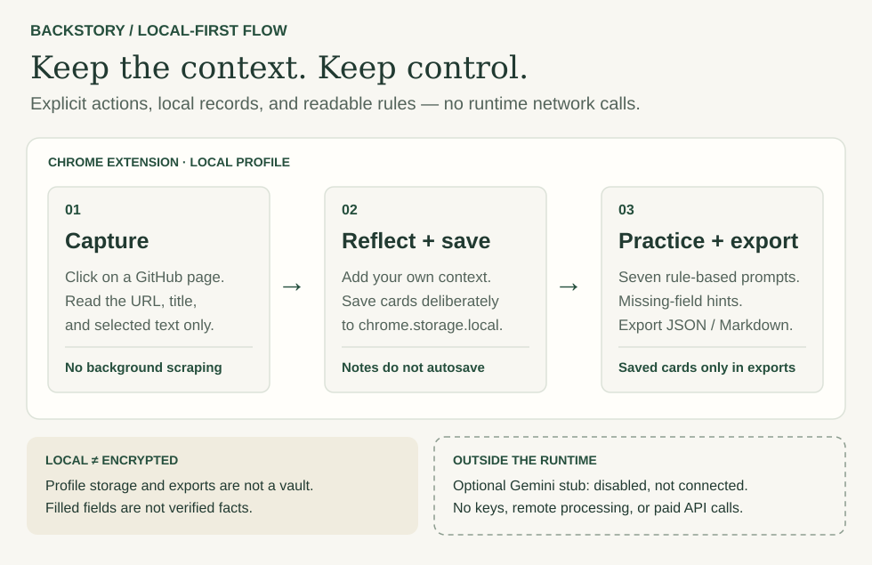

# Backstory

**Keep the decisions behind your GitHub work.** A small, local-first Chrome extension that turns your own notes and selected code into evidence cards and honest interview practice.

Backstory is a working MVP, not a factual verifier. The name is a working name and has **not** been trademark-checked.

## At a glance



**UI illustration, not a runtime screenshot.** This source-informed preview uses the app’s palette and empty-state copy, with a simplified layout and no personal records. It does not establish that Chrome extension runtime or browser QA has passed. [Visual sources and regeneration](docs/images/README.md).

## Install on desktop Chrome — no build or account required

These steps are for **desktop Chrome**, not Android Chrome. This ZIP is not an Android app; you can keep it for a desktop installation.

1. Unzip `Backstory-MVP-0.1.0.zip` and keep the extracted folder somewhere permanent.
2. In Chrome, enter `chrome://extensions` in the address bar.
3. Turn on **Developer mode**, choose **Load unpacked**, and select **`backstory/extension`** — the folder containing `manifest.json`.
4. Pin Backstory using Chrome’s extensions menu.

If you downloaded or cloned the GitHub repository instead, select its **`extension/`** directory. The surrounding folder name may differ.

This does not publish anything to the Chrome Web Store. Chrome 114 or newer is required; a current Chrome release is recommended. No browser installation was performed on your behalf.

## The first useful card

1. Open a repository page on **github.com**. Select a few relevant lines if you want code context.
2. Click Backstory in the toolbar, then **Capture this GitHub page**. Nothing is captured merely by opening the popup.
3. In the workspace, add the problem, approach, what failed or remains uncertain, your personal contribution, and evidence/outcome. Only the title is required to save a card.
4. Save. Backstory offers seven deterministic practice questions and identifies fields you have not filled in.

You can also choose **New evidence card** without capturing a page. Search saved cards, filter by missing details, edit, delete, and export the collection to JSON or Markdown. Select **Open my evidence cards** in the popup to return later.

### Small details that matter

- Captures read **only the URL, page title, and selected text**, not the whole repository or browsing history. Selection can be empty.
- Source links are restricted to HTTPS `github.com` repository-shaped paths. URLs are not fetched or verified. GitHub Enterprise and other hosts are outside this MVP.
- Query strings are removed; line/fragment anchors are preserved. Use a commit permalink when a branch file might change.
- A captured selection is capped at 20,000 UTF-16 code units (the same counting convention as HTML `maxlength`); truncation is disclosed. Title limit: 160. Each note: 8,000. URL: 2,048. Emoji can count as two units.
- The original capture is retained locally until saved as a card or explicitly discarded. Find it under **Captures to finish** if the editor is closed.
- **Notes do not autosave.** Save deliberately. Navigation within the app asks before discarding modified notes; the browser may also warn on closing. A browser crash or forced close can still lose unsaved notes.
- Saving from a stale second window is rejected rather than overwriting a newer version. Copy your unsaved text somewhere safe, then reopen the latest card.
- JSON/Markdown exports contain **saved cards only**, not unfinished captures or unsaved changes. JSON includes versioned structured data; this MVP does **not** yet include an import/restore UI.

## What “evidence” means here

A filled field is not a verified claim. Backstory cannot establish that a repository exists, that you authored its code, that a metric is accurate, or that a link proves an outcome. It never invents project history or writes accomplishment claims for you. No hidden commits, fabricated activity, or concealment features are included.

Be explicit about what you personally did, what teammates contributed, and what remains unmeasured. The question generator uses visible, deterministic templates — it is **not an AI integration**.

## Privacy and permissions

The extension requests only:

| Permission | Why it is needed |
| --- | --- |
| `activeTab` | Temporary access to the tab you explicitly invoke Backstory on. |
| `scripting` | Read the selected text/title/URL in that tab after Capture. Main frame only. |
| `storage` | Keep cards and unfinished captures in this Chrome profile’s local extension storage. |

There are no broad host permissions, persistent content scripts, background worker, remote scripts, analytics, accounts, sync, or runtime network calls. Extension CSP includes `connect-src 'none'`. Stored records are restricted to trusted extension contexts.

**Local is not encrypted.** Backstory does not encrypt its local storage or exported files. Someone who can access your device/profile may be able to read them. Do not capture credentials, API keys, or confidential code you are not allowed to retain. Review plain-text exports before sharing them.

Chrome removes local extension data on uninstall. Local storage has a quota; a full store surfaces an actionable error and keeps the last saved version. Export regularly. Deleting a card does not delete copies in downloaded exports or device backups. No claim of secure erasure is made.

## Gemini: intentionally not connected

`optional-server/` contains a readable, disabled server-side **stub**, not a running server or working AI adapter. It is not loaded by the extension. Every request fails closed, even if an enable flag is supplied. `.env.example` contains placeholders only.

No existing keys were located, read, persisted, or used. No code was sent to Gemini and no paid API calls were made. Setting up credentials and enabling external processing require separate explicit approval and implementation. See [the adapter notes](optional-server/README.md) for the future consent and security checklist.

## Code you can read

```text
.github/workflows/check.yml  Read-only Node tests, static checks, packaging CI
extension/
  manifest.json          MV3 permissions and no-network CSP
  popup.html / popup.js  Explicit capture and workspace entry
  capture.js             Small, isolated selection reader
  app.html / app.js       Evidence workspace and form state
  styles.css             Local, responsive UI; no external fonts
  core/domain.js         Validation, completeness, questions, exports
  core/storage.js        Per-record local persistence and revision locks
  assets/                Original, code-drawn extension icons
optional-server/         Disabled Gemini stub; not extension runtime
scripts/                 Checks, optional browser QA, ZIP packaging
tests/                  Node unit and UI-state regression tests
docs/                   Architecture and verification notes
```

No runtime libraries, bundler, install step, or dependency download is needed. Modules are ordinary JavaScript, styles are ordinary CSS, and tests use Node’s built-in runner.

## Develop and check

From the `backstory` directory, with Node 20.11+ and Python 3 available:

```sh
npm test          # Domain, storage, capture, adapter, UI-state regressions
npm run check    # JavaScript syntax, manifest, local assets, CSP/no-network checks
npm run package  # Validated source ZIP in dist/
```

No `npm install` is required for these commands. The GitHub Actions workflow runs these test/static/package checks on pushes and pull requests with read-only repository permission. Its status is separate from browser QA; no CI result is claimed until a run actually completes. Browser QA is a separate optional development check requiring Python Playwright and Chromium:

```sh
npm run qa
# CHROMIUM_PATH=/path/to/chromium npm run qa
```

The QA script uses a disposable profile, synthetic data, and blocks HTTP(S). It never attaches to your browser. Browser launch was blocked by the build environment’s sandbox, so **real-browser end-to-end QA and visual inspection are not claimed as passed**. See [verification notes](docs/TESTING.md) for precise coverage and the manual test checklist.

After editing the manifest, reload Backstory at `chrome://extensions`. After code/style edits, reopen the popup or refresh the workspace; reload the extension if unsure.

## Recovery and MVP limits

- A malformed or future-version stored record is preserved and surfaced, not silently repaired/deleted. It can prevent normal collection loading or export. An advanced user can inspect/export the affected raw `chrome.storage.local` record from the extension’s DevTools before repairing it. Do not uninstall or clear storage as a first recovery step.
- The app has no encryption, sync, team sharing, import UI, GitHub authentication/API, authorship verification, repository-wide indexing, or live AI.
- Bulk import, large collections, accessibility with a screen reader, and the actual Chrome toolbar-to-live-GitHub permission gesture still need dedicated user-environment QA.

## Architecture and references



Capture is explicit; notes save only when you choose. The flow is a simplified overview, not a replacement for the detailed module and security boundaries below. The opaque image backgrounds keep both visuals legible in light and dark README themes; open either SVG to zoom into its text.

[Architecture with Mermaid diagram](docs/ARCHITECTURE.md) · [Verification notes](docs/TESTING.md)

Implementation was checked against Chrome’s primary documentation on 2026-10-27:
- [The activeTab permission](https://developer.chrome.com/docs/extensions/develop/concepts/activeTab)
- [Scripting API](https://developer.chrome.com/docs/extensions/reference/api/scripting)
- [Storage API and quotas](https://developer.chrome.com/docs/extensions/reference/api/storage)
- [Declaring permissions](https://developer.chrome.com/docs/extensions/develop/concepts/declare-permissions)
- [Loading an unpacked extension](https://developer.chrome.com/docs/extensions/get-started/tutorial/hello-world)
