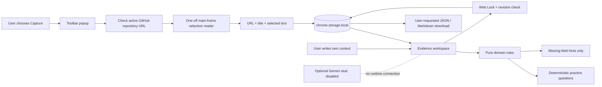

# Architecture

Small modules, explicit actions, local state. There is no build pipeline or runtime service.



## Boundaries

1. **Capture:** The popup invocation provides temporary `activeTab` access; the Capture button queries the active tab and checks its URL before requesting `chrome.scripting.executeScript`. The injected function rechecks the current origin/path to handle navigation. It accesses `location.href`, `document.title`, and `window.getSelection()`, never the document body. It returns bounded plain data. No script remains installed.
2. **Domain:** Card inputs have explicit types, maximum lengths, and supported source URL rules. Untrusted content is text, not HTML. Cards receive a UUID, schema version, creation/update timestamps, and integer revision. Questions are templates that ask for facts; they do not supply facts.
3. **Persistence:** Each card/capture has a separate namespaced key. A shared Web Lock serializes operations across extension pages, and expected revisions detect stale edits. Storage exceptions propagate with friendly errors. Damaged records are not silently rewritten. There is no localStorage fallback in production.
4. **UI:** `textContent` and form `value` handle user data. Notes save only on a user action. Busy operations block editor navigation; confirmed writes/removals are adopted before secondary collection refreshes so a refresh failure cannot masquerade as a failed save. Capture cleanup may fail independently without losing a committed card.
5. **Exports:** Explicit download via a Blob URL; no downloads permission. JSON has a versioned envelope. Markdown escapes prose and uses code fences longer than embedded backtick runs. Export is a local plaintext disclosure decision, not a secure share mechanism.
6. **Optional AI:** The server-side adapter outside `extension/` always throws a disabled error. There is no HTTP listener, API client, credential loading, or active endpoint. A future implementation needs separate authorization, request-level consent, a preview/redaction step, server authentication, secret management, and cost/rate controls. It cannot be enabled simply by changing the placeholder environment file.

## Record shape

```text
schemaVersion: 1
id: UUID
title, url, snippet: strings
problem, approach, failure, contribution, evidence: strings
createdAt, updatedAt: ISO timestamps
revision: positive integer
```

Captures instead contain `schemaVersion`, `id`, `url`, `title`, `snippet`, `truncated`, and `capturedAt`. A blank selection is valid. A blank card title is not.

## Honest constraints

Presence checks do not evaluate quality or truth. A repository-shaped URL is not proof of a repository or evidence. Browser profile storage is not an encrypted vault, and deletion is not secure erasure. Unsaved edits can be lost on a crash. The model deliberately avoids an always-on worker, whole-page scraping, all-sites access, opaque generated claims, and hidden remote processing.
